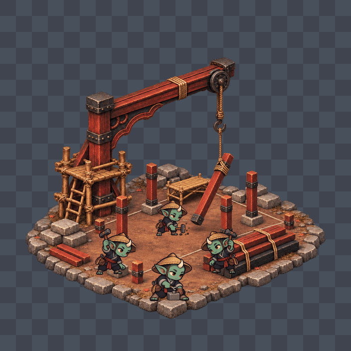

# Animation ก่อสร้าง — asia

นรกจีน/ญี่ปุ่น: ไม้แดงดำ ข้อต่อเครนโค้งเล็กน้อย เหล็กรัดสีดำ และนั่งร้านไม้ไผ่ ภาพอ้างอิงสไตล์จาก `img/Asia/BG-Tarang-asia.webp` และโครงเฟรมจาก `img/construction/th/` โดยวาดพื้นฐานด้วย ImageGen ในตัว 3 ครั้ง ไม่มี retry (งบ 14 ครั้ง/โซน)

ฐานดินล้อมหิน เสาไม้แดง และคานไม้ที่เครนกำลังยก ทั้งสามระยะไม่มีหลังคาหรืออาคารเสร็จ ใช้เป็นฉากก่อสร้างร่วมกับสถานีต่าง ๆ ได้

| ระยะ | เนื้อหา | แถบภาพ | ภาพเคลื่อนไหวตัวอย่าง |
| --- | --- | --- | --- |
| 1 | ฐานรากและวัสดุ เตรียมตั้งเสา | [stage-1.webp](stage-1.webp) | [stage-1.gif](preview/stage-1.gif) |
| 2 | เสาที่กำลังติดตั้งและวัสดุแขวนยก | [stage-2.webp](stage-2.webp) | [stage-2.gif](preview/stage-2.gif) |
| 3 | เสาสูงขึ้น นั่งร้านเปิดโล่ง และคานแขวนยก | [stage-3.webp](stage-3.webp) | [stage-3.gif](preview/stage-3.gif) |

แถบภาพ WebP แบบ lossless RGBA ขนาด 5632×704 ประกอบด้วย 8 ช่องแนวนอน ช่องละ 704×704 จุดเท้า `[352,640]` และ `worldWidth: 256` ใช้ [construction.json](construction.json) ที่กำหนด 8 fps ทุกระยะ

คนงาน 4 ตัวประกอบจาก `img/workers/worker-asia-sheet-v2.webp` โดยตรง ใช้แถว build (2) และ repair (8) ขนาดเซลล์ต้นทาง 320×320 พร้อม inset ตาม `src/workers.js` คนงานสลับท่าเป็น 8 เฟรม ส่วนเครนและโครงสร้างคงที่ภายในแต่ละระยะ พื้นหลัง GIF เป็นตารางเทาเพื่อดูขอบอัลฟา พื้นหลังของ WebP โปร่งใสจริง

ดู [ข้อกำหนดและขอบเขตการตรวจ](../README.md) และ [prompt ที่ใช้จริง / จำนวนครั้ง](generation-log.json)
