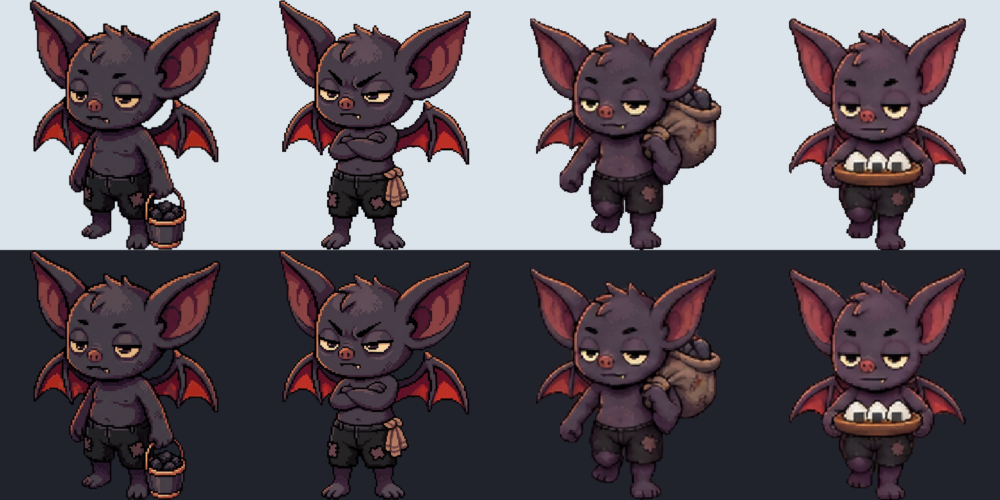

# ดำ — ภาพหัวหน้าคนงาน · 15 พ.ย. 2569

งานภาพเท่านั้น ยังไม่ได้ต่อเข้าระบบเกมหรือทดสอบในเกม ใช้ built-in ImageGen
5 ครั้งจากงบ 12 ครั้ง ไม่มีการย้อมสีด้วยโค้ด ต้นแบบทั้ง 6 ไฟล์คง SHA-256 เดิม

## ไฟล์ส่ง

| ภาพ | ขนาด | รูปแบบ |
| --- | --- | --- |
| [แบกเศษหิน](../../../img/crew-dam-carry-walk-v1.webp) + [JSON](../../../img/crew-dam-carry-walk-v1.json) | 2560×1280 RGBA | 4 แถว × 8 เฟรม, ช่อง 320 |
| [ถือข้าวปั้น](../../../img/crew-dam-carry-rice-v1.webp) + [JSON](../../../img/crew-dam-carry-rice-v1.json) | 2560×1280 RGBA | 4 แถว × 8 เฟรม, ช่อง 320 |
| [คุมครัว](../../../img/crew-dam-supervise-v1.webp) | 512×512 RGBA | กอดอก มีผ้าคาดเอวเล็กน้อย |

แถว: side หันขวา → side-left → down → up เฟรมละ 125 ms
JSON คงค่าต้นแบบทุก field ยกเว้น `image` และ `source` รวมถึงคง `dx`, `scale`,
`order` เดิมตามใบงาน Toby เป็นผู้ต่อใช้งานภายหลัง

## ภาพเทียบ

จากซ้าย: ดำต้นแบบ / คุมครัว / แบกเศษหิน / ถือข้าวปั้น
แถวบนพื้นสว่าง แถวล่างพื้นมืด ภาพเดินในภาพเทียบขยายเพื่อเทียบรายละเอียดเท่านั้น



## GIF แยกทิศ

ทุก GIF มีพื้นสว่างซ้ายและพื้นมืดขวา 640×320, 8 เฟรม วนไม่สิ้นสุด
GIF เก็บเวลาได้ทีละ 10 ms จึงใช้ 130/120 ms สลับกัน รวม 1000 ms ต่อรอบ

| ทิศ | แบกเศษหิน | ถือข้าวปั้น |
| --- | --- | --- |
| side (ขวา) | [GIF](crew-dam-carry-walk-v1-side.gif) | [GIF](crew-dam-carry-rice-v1-side.gif) |
| side-left | [GIF](crew-dam-carry-walk-v1-side-left.gif) | [GIF](crew-dam-carry-rice-v1-side-left.gif) |
| down | [GIF](crew-dam-carry-walk-v1-down.gif) | [GIF](crew-dam-carry-rice-v1-down.gif) |
| up | [GIF](crew-dam-carry-walk-v1-up.gif) | [GIF](crew-dam-carry-rice-v1-up.gif) |

## การตรวจตนเองตามเกณฑ์รับงาน

1. **ตัวละคร:** เทียบภาพต้นแบบและ sheet แล้ว คงขนเทาม่วงเข้ม หูใหญ่ด้านในแดง
   ตาเหลืองครึ่งปิด จมูกเล็ก เขี้ยว ปีกแดง ลำตัวเปลือย และกางเกงดำปะผ้า
   ภาพต้นแบบมีหูแหลม ไม่มีเขาแยกต่างหาก จึงไม่ได้เพิ่มเขาใหม่
   การประเมินว่าหน้าตาเหมือนเพียงพอเป็นการตรวจด้วยภาพ ไม่ใช่สิ่งที่ตัวเลขยืนยันได้
2. **ตำแหน่งและขนาด:** ทั้ง 64 ช่อง จุดเท้าคลาดจาก x=160 สูงสุด 3.5 px
   baseline เท่ากับ y=320 ทุกช่อง silhouette สูง 296 px เท่ากัน (แปรผัน 0%)
   วัดจุดเท้าจากกึ่งกลางช่วงที่มีเท้าทั้งคู่ในส่วนล่าง 15% แล้วฉายลง baseline
   เพื่อไม่เลือกเฉพาะเท้าข้างที่ลงพื้นและทำให้ตัวเลื่อนเมื่อสลับขา
   คุมครัวมีขอบ silhouette ที่ alpha≥128 เป็น (60,1)–(452,511)
   เทียบต้นแบบ (61,1)–(451,511): ความสูงและ baseline เท่ากัน กว้างต่างรวม 2 px
3. **Alpha:** ภาพเกมทั้งสามใช้ alpha 0/255 ไม่มีพื้นหรือเงาพื้นจากภาพต้นทาง
   ตรวจ sheet บนพื้นสว่าง/มืดแล้ว ตรวจขอบภายนอกไม่พบ pixel สว่างที่ RGB ทุกช่อง >225
   ค่านี้เป็นตัวช่วยตรวจขอบขาว ไม่ใช่หลักฐานแทนการดูภาพทั้งหมด
4. **ลูป:** sheet มี 8 playback frames ต่อทิศ ประกอบจาก **5 key poses**
   ตามลำดับ 1,2,3,4,5,4,3,2 โดยตั้งใจใช้ท่าซ้ำแบบไป–กลับ ไม่ใช่ 8 ภาพวาดที่ไม่ซ้ำกัน
   ทดสอบภาพต่างของ silhouette ระหว่างเฟรมติดกันครบทุกคู่รวม 8→1:
   รอยต่อไม่มากกว่าคู่ภายในลูปทั้ง 8 แถว ตรวจภาพแต่ละเฟรมแล้ว
   ยังไม่ได้ดูผลการเดินร่วมกับความเร็วเคลื่อนที่ในเกมหรือรับรองการเดินแบบ 8 phases ที่ไม่ซ้ำ
5. **หลักฐานรีวิว:** มี GIF 8 ไฟล์ ภาพเทียบ WebP และ [ค่าที่วัดรายเฟรม](measurements.json)
   ในโฟลเดอร์นี้ครบตามรายการข้างบน

## วิธีสร้างและตรวจซ้ำ

ต้นทาง PNG ทั้งสามอยู่ใต้ `art-src/` เท่านั้น PNG เฟรมทำงานสร้างใหม่ได้และไม่ใช่ไฟล์ส่งเกม
เครื่องมือ: Python + Pillow/NumPy สำหรับอ่านและวัด, ffmpeg สำหรับ crop/จัดช่อง/nearest scale/
alpha threshold/ทำ GIF, cwebp สำหรับ lossless WebP ไม่มีการแก้ RGB หรือย้อมสีด้วยโค้ด

```sh
python3 art-src/dam-foreman-2026-11-15/build_review.py
python3 art-src/dam-foreman-2026-11-15/build_review.py --validate-only
```

คำสั่งสร้างและคำสั่งตรวจจบด้วย exit 0 ตรวจขนาด, RGBA, 64 จุดเท้า, ความสูง,
JSON เทียบต้นแบบ, ขอบขาว, GIF 8 เฟรม/เวลา/การวน และ SHA-256 ของต้นแบบ
ผลตรวจอยู่ใน `measurements.json` ไม่มีการรัน test เกม เพราะไม่มีการเปลี่ยนโค้ดเกม
และใบงานให้ Toby ต่อสายภายหลัง ข้อมูลนี้ไม่ใช่การรับรอง QA ของเกม

ดู [prompt set และรอบที่ไม่ได้เลือกใช้](../../../art-src/dam-foreman-2026-11-15/prompts.md)
และ [สคริปต์ประกอบภาพ](../../../art-src/dam-foreman-2026-11-15/build_review.py)
