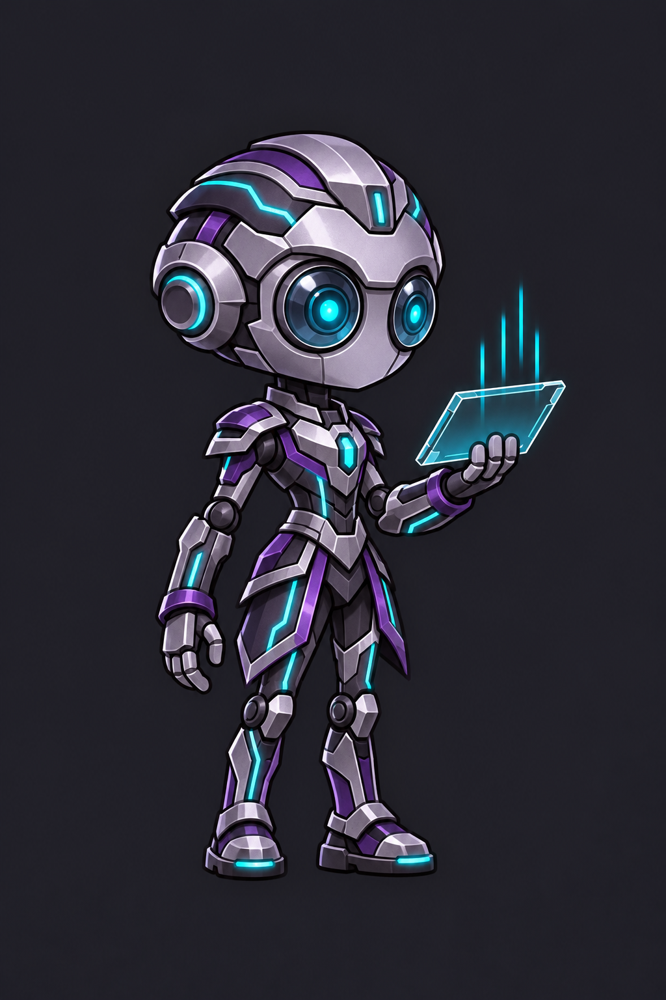

# WATSON-03 — cyberhell ชุด a

## บันทึกต้นฉบับก่อนวาด

ตรวจเปิดต้นฉบับทุกไฟล์ก่อนเริ่ม ImageGen วันที่ 20 พ.ย. 2569 ชุดนี้เป็นภาพเดี่ยวทั้งหมด กริด 1×1 จำนวน 1 เฟรม ไม่มี sheet จึงไม่มี GIF ของ sheet

| ไฟล์ | ผืน (px) | โหมด | กริด / เฟรม | กรอบ alpha เดิม (ซ้าย บน ขวา ล่าง; ขวา/ล่างไม่รวม) |
| --- | --- | --- | --- | --- |
| img/CyberHell/crew-guard-cyberhell-v2.webp | 1254×1254 | RGBA | 1×1 / 1 | 0,19,1240,1254 |
| img/CyberHell/crew-guard-cyberhell-cutscene.webp | 1375×768 | RGB | 1×1 / 1 | ทั้งผืน (ฉากทึบ) |
| img/tea-rest/crew-guard-cyberhell-sit-v1.webp | 177×219 | RGBA | 1×1 / 1 | 0,0,177,219 |
| img/z4-events/guard-watson03.webp | 512×512 | RGBA | 1×1 / 1 | 6,30,507,498 (placeholder มีข้อความ) |
| img/z4-events/guard-watson03-profile.webp | 512×512 | RGB | 1×1 / 1 | ทั้งผืน (placeholder) |

ไม่พบไฟล์ guard profile เพิ่มใน img/CyberHell ชุดนี้มี profile ใน z4-events ตามรายการ

ไฟล์ใหม่ img/ko-pose-v1/cyberhell/guard.webp ต้องเป็น 640×320 RGBA อ้างอิงท่าจาก img/ko-pose-v1/th/guard.webp (640×320 RGBA, 1 เฟรม)

แบบอนุมัติ: ../../2026-11-20-guard-designs/guard-watson03-cyberhell-v1.webp หุ่นเงินเพรียว เลนส์ตาฟ้า เส้นม่วงฟ้า แผ่นบันทึกเรืองแสง ไม่มีหมวก/ไปป์/ตัวอักษร/เลือด

## ผลงานที่ส่ง

เขียนทับภาพเดิม 5 ไฟล์ตามตารางข้างบน และเพิ่ม `img/ko-pose-v1/cyberhell/guard.webp` ครบ 6 ไฟล์ของชุด a เท่านั้น ภาพเดี่ยวทั้งหมด ไม่มี sheet ในขอบเขตนี้ จึงไม่มี GIF ของ sheet

- [ภาพเทียบเดิม | ใหม่](compare.jpg) มีแบบอนุมัติอยู่ด้านบน แถว KO ฝั่งซ้ายเป็นตัวอย่างท่าจากโซน th เท่านั้น ไม่ใช่ไฟล์ cyberhell เดิม
- [ผลตรวจและตัวเลข](validation.json) รวมขนาด โหมด กริด เฟรม SHA-256 และตำแหน่งจุดยึด
- [mask บริเวณเปลี่ยนคัตซีน](cutscene-replacement-mask.png) และ [mask ตัวหุ่นในคัตซีน](cutscene-character-mask.png) ใช้เป็นหลักฐานการวัด

## วิธีประกอบและวัด

ใช้ ImageGen ในตัวทั้งหมด 8 ครั้ง แนบแบบอนุมัติทุกครั้ง แล้วใช้ Pillow ตัด alpha จางต่ำกว่า 8 ออก ย่อ/ขยาย จัดจุดยึด และบันทึก WebP แบบ lossless ให้โหมดสีตรงต้นฉบับ ภาพยืนบนแผนที่กลับซ้ายให้ตรงทิศของตัวเดิม

จุดเท้าในผลวัดหมายถึงจุดยึดกรอบเท้าสำหรับวาง sprite: x คือกึ่งกลางขอบเขตเท้าในช่วงล่าง 8% ของความสูงตัวที่เห็น และ y คือแถวล่างสุดที่ alpha ตั้งแต่ 8 ขึ้นไป ไม่ใช่การบังคับให้ปลายรองเท้าทุกจุดทับกัน เพราะตัวละครมีรูปร่างต่างกัน ภาพยืนเดิมตัดบริเวณไม้เท้าออกจากการหากรอบเท้า โดยใช้ ROI x=350..1107, y=1150..1253 ความสูงตัวเดิมที่ไม่รวมไม้เท้า 1217 px; ตัวใหม่ 1227 px

คัตซีนเป็น RGB จึงไม่มี alpha ของตัวเดิมให้วัดอัตโนมัติ ใช้จุดกำกับด้วยสายตาในภาพเดิม: จุดยึด (495,658), ขอบบนตัว y=185 และความสูง 474 px (ไม่นับไม้เท้า) แล้ววัดตัวใหม่จาก alpha ของชั้นตัวหุ่นตาม mask ที่แนบ ตัวเลขคัตซีนจึงเป็นการเทียบกับจุดกำกับด้วยมือ ไม่ใช่หลักฐานจากเอนจิน

profile เดิมเป็น placeholder ทึบที่ไม่มีตัวละครและไม่มีเท้า จึงระบุความสูงตัวและจุดเท้าเป็นไม่เกี่ยวข้อง แทนการสร้างค่าทดแทน ส่วน event แบบยืนใช้กรอบความสูง 468 px และจุดยึดฐาน placeholder เดิม

คัตซีนเติมฉากเฉพาะบริเวณที่ตัวเก่าและไม้เท้าบังไว้ แล้วประกอบหุ่นท่าป้องกันแยกชั้น พิกเซลฉากนอก mask เปลี่ยน 0 จุด กรอบ profile ด้านนอก 9 px เปลี่ยน 0 จุด

| ภาพ | จุดยึดเดิม → ใหม่ (px) | ความสูงเดิม → ใหม่ | ความสูงเปลี่ยน |
| --- | --- | --- | --- |
| crew-guard-cyberhell-v2.webp | [698.0, 1248] → [698.0, 1248] | 1217 → 1227 | +0.8217% |
| crew-guard-cyberhell-sit-v1.webp | [89.0, 218] → [89.0, 218] | 219 → 219 | +0.0000% |
| guard-watson03.webp | [256.0, 497] → [256.0, 497] | 468 → 468 | +0.0000% |
| crew-guard-cyberhell-cutscene.webp | [495, 658] → [494.5, 658] | 474 → 474 | +0.0000% |

KO เป็น 640×320 RGBA หัวซ้าย เท้าขวา ท่านอนหงาย ไม่มีเลือด ความยาวกรอบตัว 445 px เทียบความสูงภาพยืน event 468 px = 0.950855 เท่า อยู่ในช่วง 0.9–1.0 ใช้ภาพยืน event เป็นหน่วยเทียบเพราะภาพแผนที่ใช้ความละเอียดตัวละครคนละสเกล

## บันทึกคำสั่ง ImageGen

ชุดคำสั่งยึด identity เดียวกันทุกภาพ: “slender silver robot, twin cyan lens eyes, charcoal joints, purple panels and thin cyan neon seams, glowing blank record tablet; no text, letters, numbers, blood, hat or pipe; one character, one frame, no grid.” แต่ละงานแนบภาพต้นฉบับและ `guard-watson03-cyberhell-v1.webp` เป็น identity reference

| ครั้ง | งานและคำสั่งเฉพาะ | การใช้ผล |
| --- | --- | --- |
| 1 | Full body standing map sprite; replace demon and staff; upright stance, feet apart, forearm carrying tablet; transparent alpha | ภาพแผนที่ |
| 2 | Replace foreground demon in cutscene; same low defensive stance; preserve portal, blue shield, towers, lava and platform | ตรวจแล้วไม่ได้ใช้เป็นไฟล์สุดท้าย เพราะฉากมีการเปลี่ยนรายละเอียด |
| 3 | Cross-legged tea-rest pose; hands together holding tablet on lap; bowed head; full boots visible; transparent alpha | ภาพนั่ง |
| 4 | Replace entire event placeholder including text with standing robot; centered full body; transparent alpha | ภาพ event |
| 5 | Bust portrait on dark burgundy background; same gold border; face looking right; shoulders and tablet visible; no placeholder text or diagonal lines | profile โดยนำกรอบนอกเดิมคืน |
| 6 | Supine unconscious pose; head left, feet right, arms relaxed, legs stretched, dimmed lens eyes; tablet beside forearm; transparent alpha | KO ใหม่ |
| 7 | Remove only old cutscene demon and staff; reconstruct blue shield and platform behind them; empty background plate, no robot | เติมฉากภายใน mask เท่านั้น |
| 8 | Isolated robot in wide low defensive stance; both knees bent, open palm forward and tablet at chest; no shield or environment; transparent alpha | ชั้นหุ่นสำหรับคัตซีน |

## การตรวจที่รัน

รัน Python 3 / Pillow / NumPy ตรวจจากไฟล์จริงเทียบกับ blob ต้นฉบับจาก `git show HEAD:<path>` จำนวน 40 assertions ไม่พบ assertion ที่ผิดเงื่อนไข ตรวจขนาด โหมดสี จำนวนเฟรม alpha โปร่งใส จุดยึด ความสูง อัตราส่วน KO และความคงเดิมของฉาก/กรอบ profile รวมทั้งเปิดภาพเทียบฉบับส่งเพื่อตรวจด้วยสายตา

ผลวัดรายละเอียดและ SHA-256 อยู่ใน `validation.json` ใช้ตรวจไฟล์ส่งต่อได้ ไม่รัน unit tests ของเกมเพราะไม่ได้แก้โค้ด และยังไม่ได้ตรวจภาพในเอนจิน

## ตรวจตนเองตามเกณฑ์รับงาน

1. รายการไฟล์ครบ 6 ไฟล์; ไฟล์เดิม 5 ไฟล์มีชื่อ ขนาด โหมด กริด 1×1 และ 1 เฟรมตรงเดิม จุดยึดตามวิธีที่นิยามคลาดสูงสุด 0.5 px และความสูงเปลี่ยนสูงสุดประมาณ 0.82%; คัตซีนใช้จุดกำกับด้วยมือ; profile ไม่มีจุดเท้าหรือความสูงตัวเดิมให้เทียบ
2. ตรวจด้วยสายตา: หุ่นเงินเพรียว เลนส์คู่ฟ้า เส้นม่วงฟ้า แผ่นบันทึกเรืองแสง และท่ายืน/นั่ง/ป้องกัน/นอนตามงาน ไม่มีตัวอักษร เลือด หมวกนักสืบ หรือไปป์ในภาพใหม่ แนบแบบอนุมัติในคำสั่งทุกครั้งและในภาพเทียบ
3. มี `compare.jpg`, `validation.json` และ README ภาษาไทยในโฟลเดอร์นี้ ไม่มี sheet ในชุด a จึงไม่มีรายการ GIF ที่ต้องส่ง

ไม่มีไฟล์ภาพในชุด a ที่ขาด เหลือการตรวจในเกมและการพิจารณารับแบบโดยผู้ตรวจงาน ไม่แก้ src/, tests/, zone อื่น หรือชุด b ไม่สร้าง/สลับ branch หรือ worktree และไม่ commit/push/merge/deploy
