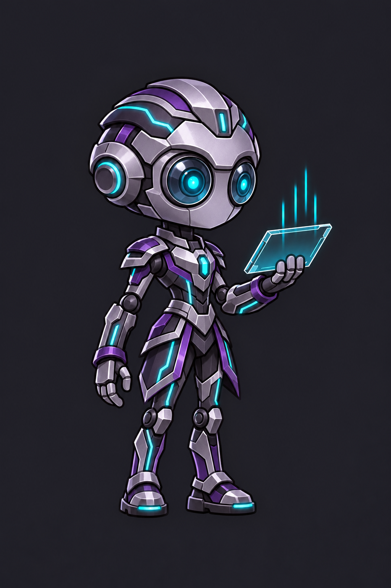

# WATSON-03 · cyberhell ชุด b

ตรวจและเปิดไฟล์เดิมทั้ง 3 ไฟล์ก่อนวาด วันที่ 20 พ.ย. 2569

| ไฟล์ | ขนาด | โหมด | กริด/เฟรม |
|---|---|---|---|
| img/crew-combat-v1/cyberhell/guard.webp |1536×1024|RGBA|4×2, 8 เฟรม เซลล์ 384×512|
| img/crew-combat-v1/cyberhell/guard-idle.webp |1024×384|RGBA|4×1, 4 เฟรม เซลล์ 256×384|
| img/CyberHell/crew-guard-cyberhell-walk-v2.webp |2172×724|RGBA|4×1 แบบ packed atlas, 4 เฟรม|

เฟรมเดินอ้างอิง src/crew-walk-assets.js (อ่านอย่างเดียว): (50,21,493,665), (608,24,478,662), (1182,23,447,665), (1698,25,457,659) คง offset (0,0), (15,3), (46,2), (19,4) และ frameSize 493×667

ค่าต้นฉบับรายเฟรมอยู่ใน originals.json; สำเนาภาพเดิมและเฟรมตัดอยู่ใน source/

แบบที่อนุมัติ: ../../2026-11-20-guard-designs/guard-watson03-cyberhell-v1.webp
ใช้ ImageGen ในตัว วาดทีละเฟรม พร้อมแนบแบบทุกครั้ง ไม่ส่ง sheet เข้า ImageGen




## วิธีทำและหลักฐาน

- วาดด้วย ImageGen ในตัวรวม 12 ครั้ง แนบแบบที่อนุมัติทุกครั้ง และแนบเฟรมต้นฉบับเฉพาะท่านั้น ไม่ส่งภาพทั้ง sheet เข้า ImageGen
- เฟรมต่อสู้ 0, 1, 2, 4, 6, 7 วาดแยก; เฟรม 3 ใช้ท่าแทงเฟรม 2 ปรับขนาดและเอนเล็กน้อย; เฟรม 5 ใช้ท่าพร้อมเฟรม 0 ปรับขยับเล็กน้อย
- Idle วาด 1 เฟรมแล้วสร้างการหายใจ 4 เฟรมด้วย Pillow; เดินวาดแยก 4 ท่า และวาดเฟรมเดิน 2 ใหม่อีกครั้งเพราะต้นร่างวางมือ/ช่วงขาไม่ตรง จึงไม่ใช้ต้นร่างนั้นในภาพส่งจริง เฟรมใหม่ประกอบกลับด้านลำตัว/แขน/ขาโดยแยกคงศีรษะหันซ้าย ใช้จุดตัดคอภาพสร้าง y=505 และเลื่อนศีรษะ -22 px ก่อนย่อ ตรวจรอยต่อด้วยตาแล้ว รายละเอียดอยู่ในสคริปต์
- `prompts.json` เก็บ prompt และรูปอ้างอิงทุกครั้ง; `frames/*-generated.png` คือภาพที่เลือกใช้ก่อนประกอบ; `frames/walk-2-rejected.png` คือภาพร่างที่ไม่เลือก
- Pillow เก็บ alpha โปร่งใสจริง ตัดเศษจิ๋ว ปรับขนาดและวางตามจุดเท้าต้นฉบับ แล้วบันทึก WebP แบบ lossless และเปิดอ่านกลับเพื่อตรวจ
- `build_review.py` เป็นสคริปต์ประกอบและตรวจไฟล์ในโฟลเดอร์รีวิวเท่านั้น ไม่มีการเรียกบริการสร้างภาพ ไม่มีการแก้โค้ดเกม

## นิยามผลวัด

`validation.json` เก็บผลรายเฟรมทั้ง 16 เฟรม ใช้พิกเซล alpha ตั้งแต่ 16 ขึ้นไป: จุดเท้าแกน Y คือพิกเซลล่างสุด ส่วนแกน X คือกึ่งกลางขอบซ้าย-ขวาของรอยเท้าในแถบล่าง 12% ของ silhouette วิธีนี้ไม่แกว่งตามจำนวนพิกเซลของพื้นรองเท้าที่อยู่สูงต่างกันเล็กน้อย

ความสูงตัวใช้ยอด silhouette เป็นตัวแทนยอดศีรษะในท่าที่อุปกรณ์ไม่สูงกว่าศีรษะ ท่ายกอุปกรณ์ (combat เฟรม 1) ตรวจยอดเกราะศีรษะต้นฉบับที่ y=137 และยอดศีรษะภาพสร้างที่ y=325 แยกจากอุปกรณ์ที่ยกสูง แล้วจัดให้ความสูงจากยอดศีรษะถึงเท้าตรงต้นฉบับ ความสูง silhouette รวมอุปกรณ์ของเฟรมนี้จึงเปลี่ยนได้และรายงานแยกไว้ ไม่ใช้แทนความสูงตัว

## ไฟล์สำหรับตรวจภาพ

- [ภาพเดิม | ใหม่](compare.jpg)
- [GIF ต่อสู้ 8 เฟรม](combat.gif)
- [GIF ยืน 4 เฟรม](idle.gif)
- [GIF เดิน 4 เฟรม](walk.gif)
- [ผลวัดรายเฟรม](validation.json)

GIF ใช้ฉากหลังสีเข้มสำหรับดูขอบภาพเท่านั้น ไฟล์ WebP ที่เกมใช้ยังเป็น RGBA โปร่งใสทั้งหมด เฟรมเดินใน GIF วาง offset ลงผืน 493×667 ตาม manifest เดิม

## ข้อจำกัดการตรวจ

เปิดดูภาพเปรียบเทียบ เฟรมที่สร้าง และเฟรมที่ถอดอ่านจาก GIF ครบทุกเฟรม แต่ยังไม่ได้เปิดเกมทดสอบการเล่นจริง ผลวัดความสูงเป็นการวัดจากภาพและจุดอ้างอิงข้างต้น ไม่ใช่การตรวจข้อต่อทางกายวิภาคแบบอัตโนมัติ


## ผลตรวจสุดท้ายและตรวจตามเกณฑ์รับงาน

คำสั่งที่รันจากราก repo:

```sh
python3 docs/art-reviews/2026-11-20-guards/cyberhell-b/build_review.py
git diff --check
```

ทั้งสองคำสั่งจบด้วย exit code 0 สคริปต์ประกอบตรวจการเปิดอ่าน WebP กลับ ขนาด โหมด กรอบเฟรม จุดเท้า ความสูง และจำนวนเฟรม GIF ผลคือ 3 ไฟล์ 16 เฟรม ค่าคลาดจุดเท้าสูงสุด 0.5 px และความสูงตัวตามจุดอ้างอิงต่างสูงสุด 0.0%

ยังรันตรวจแยกด้วย Python โดยเปิดต้นฉบับผ่าน `git show HEAD:<path>` เทียบขนาด/โหมดไฟล์ส่ง ตรวจ SHA-256 ตาม validation.json, bbox จาก alpha ของทุกเฟรม, ความโปร่งใสภายนอกกรอบ atlas, ถอดอ่าน GIF ทุกเฟรม และตรวจขอบเขต `git diff --name-only`/ไฟล์ใหม่ ผลตรวจยืนยันว่าแก้ภาพเดิมเพียง 3 ไฟล์ และไฟล์ใหม่อยู่ใน cyberhell-b นี้ทั้งหมด ไม่ได้แก้ src/, tests/, hooks, status.json หรือ worklog.json

1. **ความครบและรูปแบบไฟล์:** ครบ 3 ไฟล์ชื่อเดิม ขนาดเดิม RGBA เดิม ต่อสู้ 4×2 (384×512) ยืน 4×1 (256×384) และเดิน 4 กรอบ packed atlas เดิม จุดเท้าไม่เกิน ±2 px และความสูงตามจุดอ้างอิงไม่เกิน ±3% ผลรายเฟรมอยู่ใน validation.json พร้อมวิธีวัดและข้อจำกัด
2. **ตัวละครและท่า:** เปิดดูภาพส่งทุกเฟรมเทียบแบบ WATSON-03 หุ่นเงินเพรียว เลนส์ตาฟ้า เส้นม่วงฟ้า ถือแผ่นบันทึกเรืองแสง ไม่มีหมวก ไปป์ ตัวอักษรหรือเลือด รักษาท่าพร้อม/ยก/แทง/เหวี่ยง/โดนตี/ย่อ และวงจรเดิน เฟรมเดิน 2 ใช้การประกอบศีรษะกับลำตัวตามที่อธิบายข้างต้น
3. **หลักฐานส่งงาน:** มี compare.jpg แบบเดิมซ้าย-ใหม่ขวา มี combat.gif, idle.gif และ walk.gif และ README ภาษาไทยนี้ พร้อม prompt ครบ 12 ครั้ง ไม่ส่งทั้ง sheet เข้า ImageGen

ไม่มีไฟล์ชุด b ที่ขาด การตรวจครั้งนี้เป็นการตรวจไฟล์ภาพและเปิดดูภาพ ไม่ได้เปิดเกมเพื่อรับรอง QA การเล่นจริง ไม่ได้ commit, push, merge หรือ deploy
