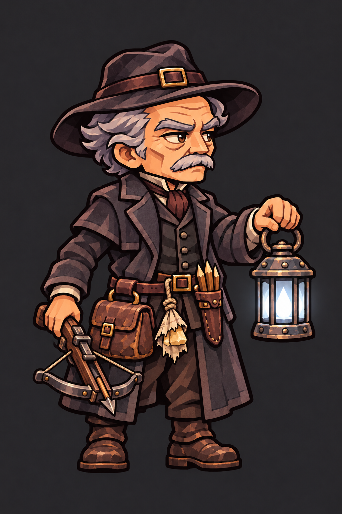

# west ชุด b — แวน เฮลซิง

เริ่มตรวจไฟล์เดิมก่อนวาด: 20 พฤศจิกายน 2569 เวลา 17:45 น. (ไทย)
ใช้ skill imagegen และ ImageGen ในตัว วาดทีละเฟรม อ้างอิงแบบที่อนุมัติทุกครั้ง แล้วประกอบด้วย Pillow

## ขนาดและกริดเดิม

| ไฟล์ | ขนาด | กริด | เซลล์ | เฟรม | โหมด |
|---|---|---|---|---|---|
| img/crew-combat-v1/west/guard.webp | 1536×1024 | 4×2 | 384×512 | 8 | RGBA |
| img/crew-combat-v1/west/guard-idle.webp | 1024×384 | 4×1 | 256×384 | 4 | RGBA |
| img/West/crew-guard-west-walk-v2.webp | 2172×724 | 4×1 | 543×724 | 4 | RGBA |

เปิดดูต้นฉบับครบ 3 ไฟล์และภาพแบบแล้ว ภาพเดิมเก็บใน originals/ และผลวัดก่อนเริ่มอยู่ใน baseline.json
กริดเดินเป็น 4 ช่องกว้าง 543 พิกเซล (ค่าครอปของเกมอยู่ภายในแต่ละช่อง)

## แบบที่อนุมัติ

ชายสูงอายุ หนวดและผมสีเทา หมวกปีกกว้าง เสื้อโค้ทยาวสีเข้ม กระเป๋าหนัง หน้าไม้มือขวา ตะเกียงมือซ้าย ไม่มีสัญลักษณ์ศาสนา ไม่มีตัวอักษรหรือเลือด

## สถานะ

กำลังวาดและตรวจวัด ยังไม่สรุปผลตรวจรับ
