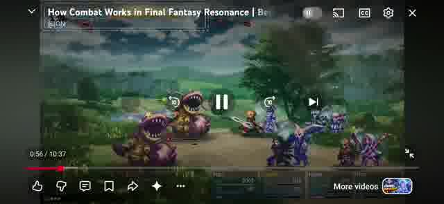
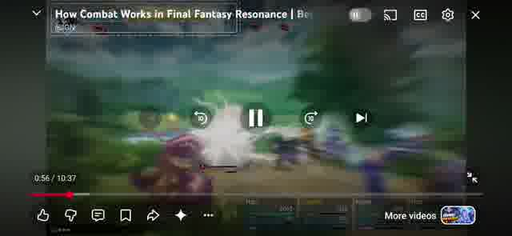
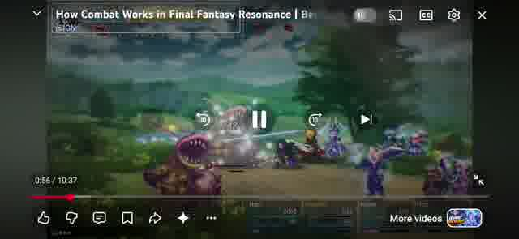
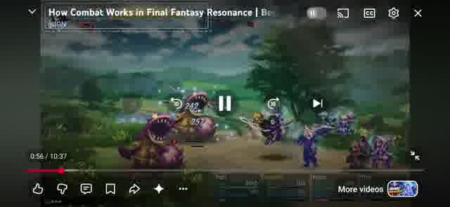
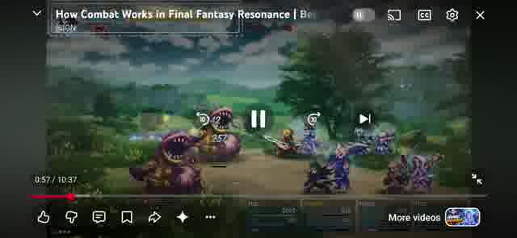
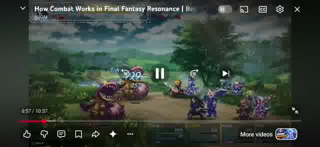

# B1 — จังหวะอ้างอิง

ต้นฉบับ: `/Users/agapae/agapae-work/refs/battle-ref-20261022.mp4` (ประมาณ 34 วินาที)
ตรวจทั้งคลิปด้วย ffmpeg 6 fps; `ref-contact.jpg` คือ contact sheet ทั้งคลิป และ `ref-melee.jpg` ขยายช่วง 9–14 วินาที ตัวละครฝ่ายผู้เล่นอยู่ขวาและพุ่งไปหาศัตรูซ้าย จังหวะเทียบกลับด้านได้กับ AVEGEE ที่ฝ่ายเราอยู่ซ้าย

ช่วงที่ใช้วัด: ประมาณ 11,000–11,833 ms ของไฟล์ (ไม่ใช่เวลาของวิดีโอ YouTube ที่ซ้อนอยู่ในภาพ) การสุ่มตัวอย่าง 6 fps มีความคลาดเคลื่อนอย่างน้อยหนึ่งเฟรม ≈167 ms; ไม่อ้างว่าเป็นการวัด hit frame แบบเฟรมต่อเฟรมของต้นฉบับเกม

| ช่วง | เวลาไฟล์โดยประมาณ (ms) | จากออกตัว (ms) | สิ่งที่เห็น |
|---|---:|---:|---|
| เตรียม/ออกตัว | 11,000 | 0 | ตัวละครขวาอยู่แถวเดิม |
| พุ่งเข้าหา | 11,167 | 167 | ภาพเคลื่อน/เบลอไปทางซ้าย |
| ถึงตัวและฟัน | 11,333 | 333 | นักดาบอยู่หน้าศัตรู มีประกายฟัน |
| hit/ดาเมจ | 11,333–11,500 | 333–500 | ประกายและตัวเลขซ้อนบริเวณศัตรู |
| ถอนตัวกลับ | 11,500–11,667 | 500–667 | ตัวละครถอยไปทางทีมขวา |
| อยู่ที่เดิม | 11,833 | 833 | แถวทีมกลับนิ่ง |

ภาพสำคัญ 7 ภาพ (ชื่อ frame คงตามลำดับการตัด 6 fps; timestamp ≈ `(เลข-1)/6` วินาที):

| เวลา ms | ภาพ |
|---:|---|
| 11,000 |  |
| 11,167 |  |
| 11,333 |  |
| 11,500 |  |
| 11,667 |  |
| 11,833 |  |
| 12,000 |  |

## จังหวะที่ใส่ในโค้ด

| ช่วง | AVEGEE ยมบาท atk (ms จากเริ่ม sequence) |
|---|---:|
| ออกตัว | 0–60 |
| พุ่ง | 60–230 |
| เริ่มท่าฟันเมื่อถึงเป้าหมาย | 230 |
| ลงดาเมจครั้งเดียว (ผลรวม sword frames 1–4 =260 ms) | 490 |
| จบท่าฟัน/เริ่มกลับ | 810 |
| ถึงจุดเริ่ม/ปล่อยเทิร์น | 980 |

รักษา sprite ฟันเดิมครบ 580 ms จึงยาวกว่าช่วงตัวอย่างที่สังเกตได้ประมาณ 147 ms (อยู่ในความละเอียดเฟรมที่ใช้วัด) ลูกทีมใช้ contact จากครึ่งแรกของ durations ใน atlas และจบท่าตาม durations ทั้งหมด; ถ้า catalog ยังไม่พร้อมใช้ 260/580 ms เป็น fallback นิราโจมตีธรรมดาใช้จังหวะ fallback นี้ ส่วนรักษาของนิราคงเดิม

ระยะหยุด = ขอบ sprite ที่ไม่โปร่งใสของเป้าหมาย − ขอบ sprite ผู้โจมตี − ช่องว่าง 8 px; จัดระดับเท้าให้ตรงกัน ระยะเดินจึงปรับตามเป้าหมายและขนาดจอ ไม่มีค่า lunge ระยะคงที่สำหรับท่าที่อยู่ใน sequence

| คำสั่ง | พุ่งหรือไม่ | หมายเหตุ |
|---|---|---|
| atk (ยมบาท), strike (ลูกทีมทุกตัวรวมโจมตีธรรมดานิรา) | พุ่ง | รอถึงตัวก่อนเริ่ม pose |
| crew:dam, crew:taan, guard | พุ่ง | ท่าประชิด; ตัดภาพคั่นออกเพื่อให้เห็นการเข้าไปตี |
| fire, flameCharge, ice, windFan/wind, valkyrieSpear, hypno | ไม่เข้า sequence ใหม่ | ใช้ทางเดินเอฟเฟกต์/เวลาเดิมทั้งหมด รวม flameCharge ที่มีเอฟเฟกต์พุ่งเดิม |
| crew:plerng, crew:kan | ไม่เข้า sequence ใหม่ | สกิลไฟ/สะกดจิตเดิม |
| crew:nira, crew:boon | ไม่เข้า sequence ใหม่ | รักษาเดิม |
| rage, mirror, cooldownClock, ไอเท็ม, defend, flee | ไม่เข้า sequence ใหม่ | พฤติกรรมเดิม |
| ศัตรูธรรมดา เมื่อฝ่ายเรามี actor เดียว ไม่มี stun/confuse/burn และไม่ใช่ boss | พุ่ง | ใช้ sequence เดียวกัน เรียก runEnemyTurn ตอน hit ไม่สุ่มเป้าซ้ำ |
| ศัตรูกรณีอื่น | เดิม | งานต่อ: แยกแผนเลือกเหยื่อและผลโจมตีออกจาก runEnemyTurn ก่อนรองรับการพุ่งตามเป้าสุ่มหลายตัว/ultimate ไม่ต้องสร้าง sprite ใหม่ |
| reduced motion ของ sequence | ไม่พุ่ง | pose/hit/ปล่อยเทิร์นยังเรียงเหมือนเดิม; delta เป็นศูนย์ |

ไม่พบปุ่มเร่ง/ข้ามท่าต่อสู้ใน openBattle; ปุ่มข้ามบทนำ/เดินทางเป็นคนละระบบ ปุ่มพักยังหยุดนาฬิกา sequence ได้
