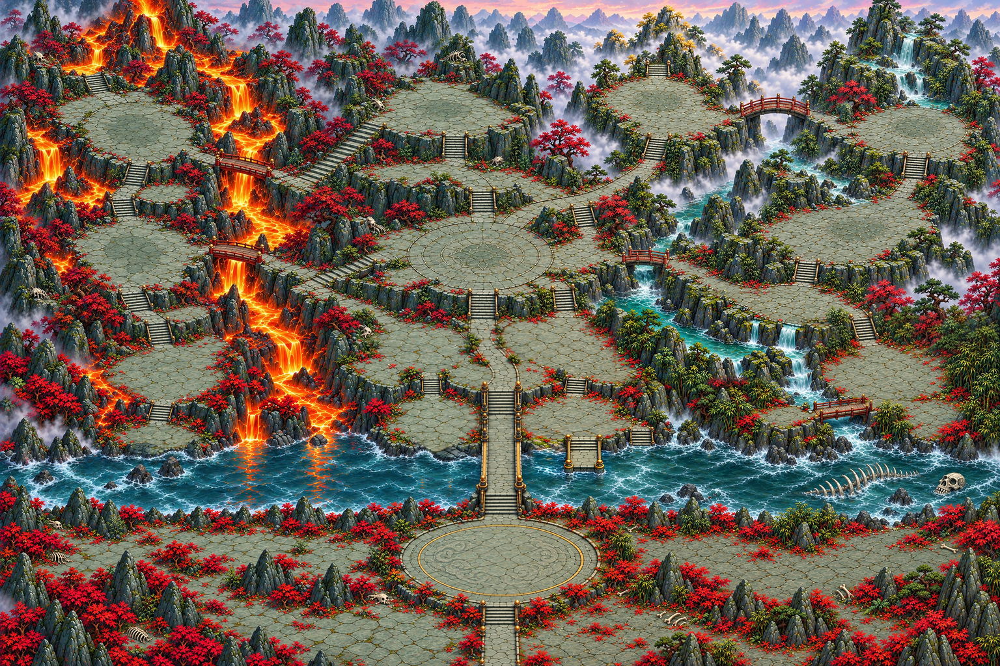

# M3b — Asia: พื้น Q5 และบ้าน S2b พร้อมส่งตรวจ

ทำใน worktree/branch `codex/20261023T061529Z-392dd4a6` ที่ได้รับเท่านั้น ฐาน `0f95200` ไม่สร้าง/สลับ branch ไม่ commit/push/merge/deploy ไม่เรียก agent ไม่แก้ hooks, status.json หรือ worklog.json

## ไฟล์ที่เสียบ

- นำ diff ของ M3 `036c9f2` เฉพาะ `src tests index.html scripts docs img` ด้วย `git apply` (ไม่ใช้ `--index` เพราะ git metadata อ่านอย่างเดียว) ไม่รับ `output/` ของ M3
- `src/zone-skin.js`: asia เปิดใช้ terrain `img/map-zone2/v1/`, `repairs:false` และ sprite ครบ judgment/houses/trees/lamp/torch/rock; ต้นไม้ asia ทำให้ `finalize()` ตั้ง `treeTint=false` ตามระบบเดิม ไม่เปลี่ยนสูตร tint
- Q5 จาก worktree `20261023T060215Z-4c7f2b03`: คัดลอก 4 quadrant มาที่ [quadrants/](quadrants/) แล้วต่อด้วย `python3 scripts/stitch-town-terrain.py --zone asia --src output/m3b/quadrants` ได้ผืน 4915×3277, 20 tiles, preview 1536×1024 q92 ที่ `img/map-zone2/v1/` ดู [stitch-report](../../img/map-zone2/v1/stitch-report.json) และ [hash ต้นทาง](q5-source-hashes.json) คัดลอกตรงทุกไบต์
- บ้าน 4 ไฟล์ `img/town-district/house-{front-one,right-one,left-two,right-two}-asia-v1.webp` จาก `codex/20261023T060219Z-abcf9bb4` ด้วย `git show` ไม่รับโค้ดจาก branch ภาพ ตรวจ RGBA/ขนาด/alpha bbox เท่าบ้านโซน 1 ทุกหลัง ดู [ค่าตรวจ](asset-verification.json)
- เปิดดู crop จุดเสี่ยงของบ้านทั้ง 4 ที่ขยาย 400% บนพื้นเข้มและอ่อนซ้ำ รวม [right-one จุดเดิม](review/right-one-suspect-edge-before-after-400.png) ไม่เห็นขอบชมพู/ขาวชัดใน crop หลังแก้ จึงเปิด houses ทั้งกลุ่ม การตรวจรอบนี้เป็นจุดเสี่ยงจาก S2b ไม่ได้ตรวจ contour ทั้ง 44 หน้าซ้ำ และไม่รับรองทุกพิกเซล
- Sprite M3 เดิม 8 ไฟล์: `img/theme-v4/town-{judgment-asia-v2,tree-asia-v1,tree-b-asia-v1,tree-c-asia-v1,landmark-asia-v1,lamp-asia-v1}.webp` และ `img/map-zone2/{torch-pillar-v1,prop-rock-v1}.webp`
- `src/town-map.js`, `src/ui.js`: นำการแสดงชื่อโซนจาก M3; โซน 1 ใช้ข้อความเดิม
- `index.html`: cache-bust zone-skin/town-map/ui เป็น `m3b` ทั้ง import map และ UI entry ไฟล์ภาพทั้งหมดเป็น URL ใหม่เมื่อเทียบฐาน ไม่มีการเขียนทับภาพโซน 1
- `tests/m3-asia-skin.test.mjs`: เปลี่ยน assertion จากพื้น/บ้านสำรองเป็นพื้น Q5 + houses ตรวจ 20 URLs, no repairs/flow/tint และโซน 1 เดิม เทสต์/fixture ที่เหลือนำจาก M3 ตามใบงาน รายการไฟล์ tracked อยู่ [changed-tracked-files.txt](changed-tracked-files.txt)

## ภาพพื้นจาก assets ที่ runtime ใช้

[ภาพ preview จาก 20 tiles](asia-runtime-tiles-preview.png) ต่อด้วย PIL ที่ขนาดจริงแล้วลดเป็น 1536×1024 เป็นภาพพื้นเท่านั้น ไม่ใช่ screenshot เบราว์เซอร์และไม่ใช่หลักฐานเดินเกมจริง

เปิดดูผืน preview หลังต่อแล้ว เก็บ crop 512×512 ที่ native 100% ของ [ท่าเรือ](asia-pier-native.png), [ฝั่งกลาง](asia-shore-native.png), [รอยต่อน้ำ](asia-water-seam-native.png) ให้ผู้ตรวจดูเพิ่ม ภาพมีความนุ่มจากการขยาย quadrant ประมาณ 1.8× ตาม stitch-report

## ผลตรวจและเทสต์

- รอบแรก `node --test tests/*.test.mjs`: 1389 ผ่าน / 1 ไม่ผ่าน / 0 skipped, 233355 ms ดู [log รอบแรก](node-test-initial.log) สาเหตุคือการ pin `treeTintAuto:false` ที่เพิ่มในรอบนี้ทำให้ dev-hook เปลี่ยนกลับไปใช้ต้นไม้สำรองแล้วยังไม่ tint จึงนำ pin ออก ใช้ `finalize()` เดิมแทน ไม่มีการแก้ test ให้ยอมรับพฤติกรรมผิด
- หลังแก้ `node --test tests/m2-zone-skin.test.mjs tests/m3-asia-skin.test.mjs`: 13 ผ่าน / 0 ไม่ผ่าน ดู [skin-test.log](skin-test.log)
- ชุดเต็มรอบสุดท้าย `node --test tests/*.test.mjs`: **1390 ผ่าน / 0 ไม่ผ่าน / 0 cancelled / 0 skipped**, 234044.584 ms, exit 0 ดู [node-test.log](node-test.log) ไม่มีการแก้ runtime/test หลังรอบนี้
- `node --check src/zone-skin.js`, `node --check src/town-map.js`, `node --check src/ui.js` และ `git diff --check`: exit 0
- Python/Pillow assertions: ขนาด tiles 20 ชิ้นตาม grid, RGBA/ขนาด/bbox บ้าน 4 หลัง, bytes ของ quadrant 4 ไฟล์ตรง Q5: ไม่มี assertion error ดู [asset-verification.json](asset-verification.json) และ [q5-source-hashes.json](q5-source-hashes.json)
- Node assertions เทียบ `ZONE_SKIN.th` ทั้งก้อนกับ module จาก `git show 0f95200:src/zone-skin.js`: deep-equal; west/cyberhell เท่าเดิม; game/data/layout/masks/ภาพพื้นโซน 1 ไม่มี diff ดู [scope-verification.json](scope-verification.json)
- ไม่มีการอ้าง QA ผ่าน

## ชุด mask ใหม่

คำสั่ง `python3 scripts/make-town-mask-overlay.py --zone asia --ground img/map-zone2/v1/zone2-terrain-v1-preview.webp --out output/m3b/mask-for-kittanate/asia` จบ exit 0 ดู [mask-generation.log](mask-generation.log)

ส่งคุณเป้ที่ [mask-for-kittanate/asia/](mask-for-kittanate/asia/): [พื้นสะอาด](mask-for-kittanate/asia/asia-ground.png), [ภาพทับ mask](mask-for-kittanate/asia/asia-mask-overlay.png), [เลเยอร์แดงโปร่งใส](mask-for-kittanate/asia/asia-mask-layer.png), [วิธีวาด](mask-for-kittanate/asia/HOWTO-mask.txt) ทั้ง 3 ภาพ 1536×1024

ตรวจด้วย Pillow/NumPy: พื้นตรง decoded Q5 preview ทุกพิกเซล, layer ตรง current floor dump, overlay ตรงการ composite ทุกพิกเซล และ floor dump asia เท่ากับโซน 1 ชั่วคราวเต็มภาพ (354590 preview pixels เดินได้) ไม่มีการเขียน mask เกม ดู [mask-verification.json](mask-verification.json)

## Self-check เกณฑ์รับงาน

| เกณฑ์ | ผลและหลักฐาน |
|---|---|
| โซน 2 ใช้พื้นใหม่ | ตั้ง skin ไป Q5 ใน `img/map-zone2/v1/`; 20 tiles/preview อยู่จริง, production-config test ตรวจ URLs และ repairs:false |
| เทสต์ 0 แดง | ชุดเต็มสุดท้าย 1390/1390, exit 0; รอบแรกที่ผิดเก็บ log และอธิบายสาเหตุไว้ |
| โซน 1 ไม่เปลี่ยน | deep-equal skin ทั้งก้อนกับฐาน, ไม่แก้ภาพพื้น/layout/mask/game values; ชุดเดิมรวมการกลับโซน 1 รันครบ |
| ชุด mask ใหม่ | ครบพื้น/layer/overlay/HOWTO บนพื้น Q5 และตรวจเทียบพิกเซลกับ current floor แล้ว |

เป็นผลตรวจโค้ด/เทสต์/ไฟล์ภาพ ไม่ใช่การรับรอง QA การเล่นจริง

## สิ่งที่ค้าง

- ใช้ walk mask โซน 1 ชั่วคราวตามคำสั่ง คุณเป้วาดของ asia ภายหลัง ไม่เขียนทับ mask เกม ชุดภาพส่งวาดไม่ได้ทำให้ mask ในเกมเปลี่ยน
- `flowUrl:null`: town-flow รองรับไม่มี field และข้าม optional particle effects ได้ ไม่ใช้ flow โซน 1 บนภาพใหม่ รอ profile ที่ trace และตรวจขอบกับน้ำ/ลาวา Q5 ก่อน bake; ระบบพื้น/เดินไม่ได้บังคับใช้ flow
- ยังไม่ได้ตรวจการเล่น/ภาพในเบราว์เซอร์จริง; หลักฐานภาพเป็น PIL จาก tiles และ crop sprite เท่านั้น
- ข้อจำกัด Q5 ที่ต้นทางบันทึกเรื่องขอบขึ้นฝั่ง, ความสูงเสาท่า, deck เทียบ mask และการวัดรอยต่อ/guide ทุกเส้นยังส่งให้ Claudy ตรวจต่อ การเสียบพื้นตามใบงานนี้ไม่ได้รับรองเกณฑ์วาดภาพเหล่านั้นครบ
- ส่ง Claudy ตรวจและ merge โดยผู้รับงาน ไม่มีการ merge หรือ deploy ในงานนี้
